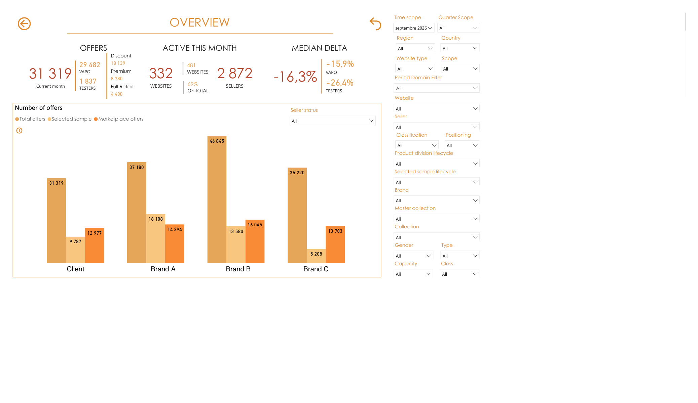
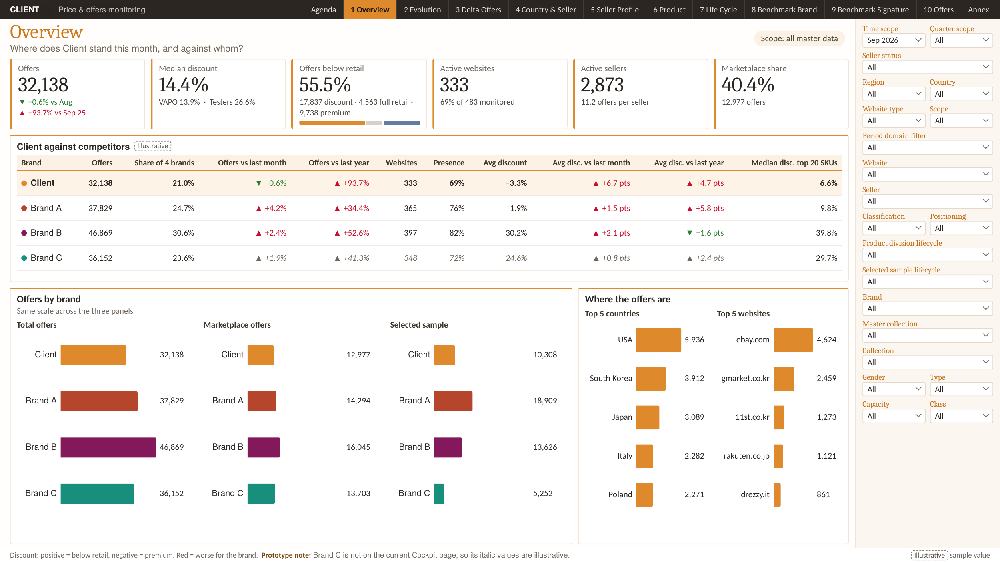
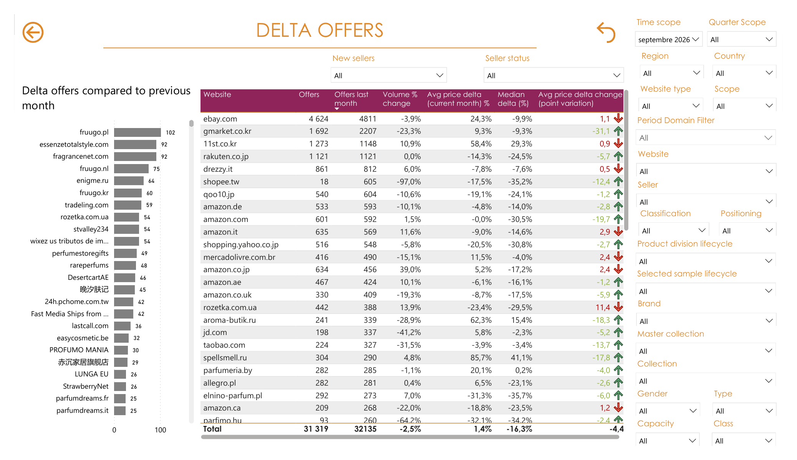
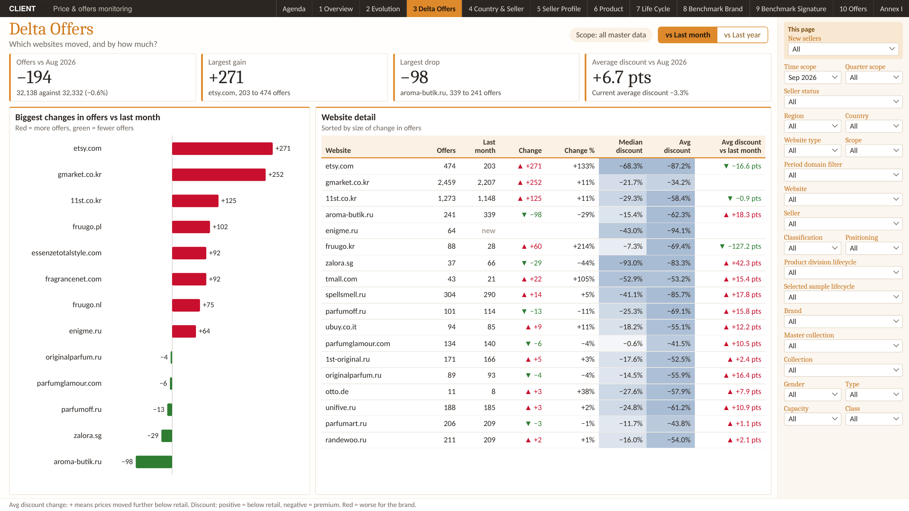
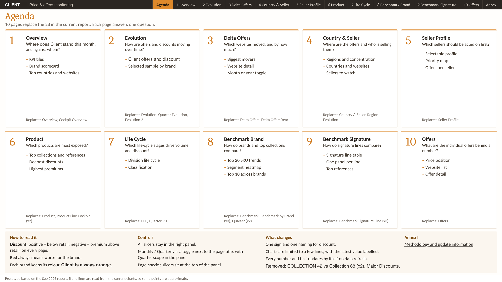
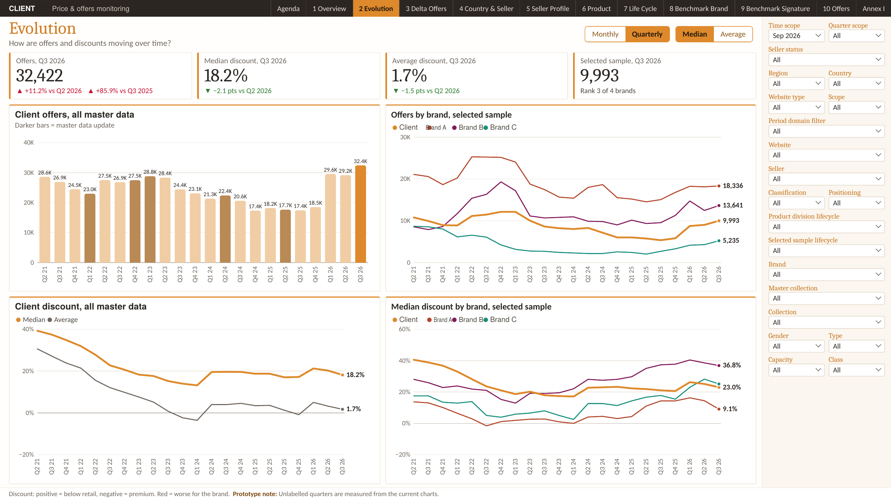
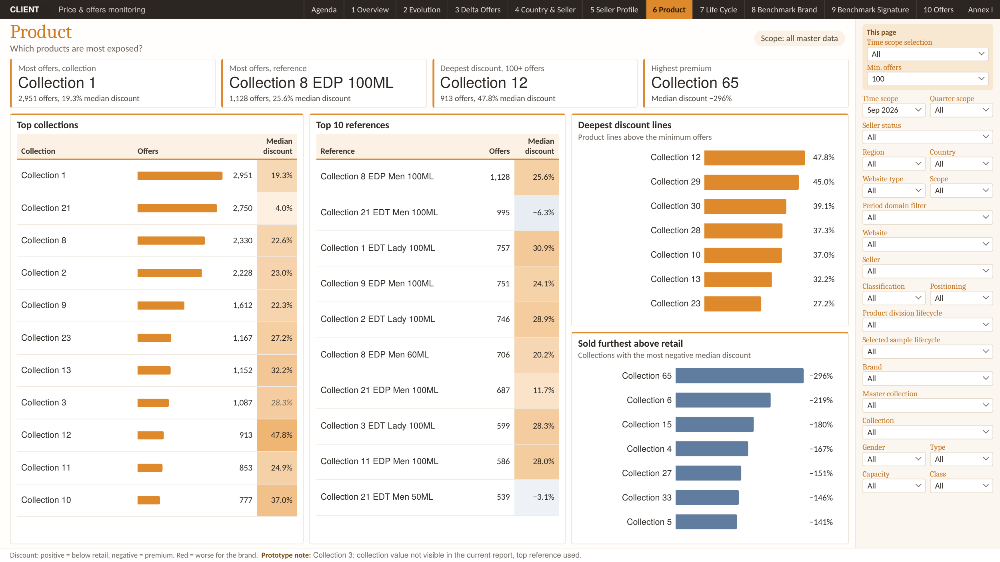
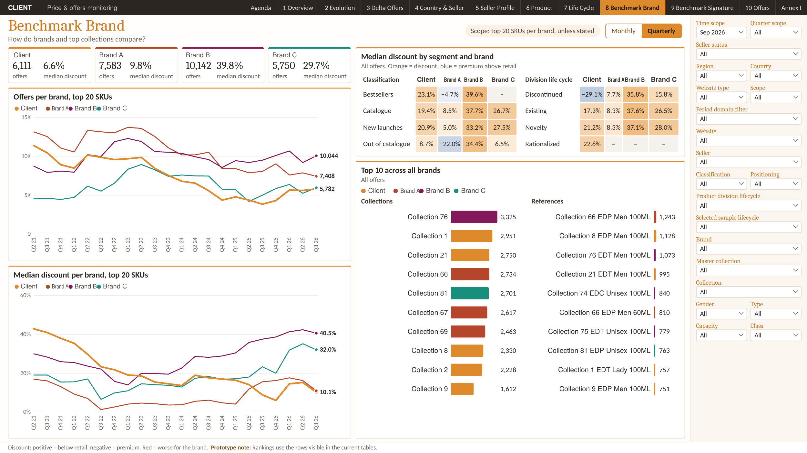

# Dashboard de suivi des prix et des offres – Refonte (Power BI)

**En bref :** j'ai refait un rapport Power BI qui aide une marque de parfums de luxe à suivre ses produits
vendus en ligne en dehors de son réseau officiel. Le rapport passe de 28 à 10 pages, chaque page répond
à une question métier, et toutes les nouvelles mesures DAX sont organisées et documentées.
*Outils : Power BI · DAX · Power Query · MySQL*

> Le nom du client, des concurrents et des produits a été anonymisé (Client, Brand A/B/C, Collection 1, 2…).
> Ce projet est un prototype en cours, réalisé pendant un stage data (Paris, 2026).

## Problème métier
Des parfums authentiques sont vendus sur de nombreux sites en dehors du réseau officiel de la marque,
souvent moins cher que le prix public. Le rapport, livré chaque mois à la marque, l'aide à :
- suivre le nombre d'offres et les remises dans le temps
- repérer les sites et les vendeurs à traiter en priorité
- voir quels produits sont les plus exposés
- se comparer à 3 marques concurrentes

## Données
- Offres collectées chaque mois sur environ 480 sites dans le monde (marketplaces et boutiques en ligne), depuis 2021
- Une ligne = une offre : marque, produit, site, vendeur, pays, prix de l'offre, prix public
- Remise = (prix public − prix de l'offre) / prix public
- Source : base de données MySQL, chargée avec Power Query

## Mon rôle
- Audit du rapport existant (28 pages) et création d'un prototype de la nouvelle version
- Construction du nouveau rapport : 10 pages, une question par page, tous les segments dans un panneau à droite
- Règles de lecture communes : un seul signe pour la remise, une couleur fixe par marque, le rouge = mauvais pour la marque
- Écriture des nouvelles mesures DAX et organisation (un dossier par page, règles de nommage, documentation)
- Mise à jour mensuelle du rapport pendant mon stage

## Mesures DAX clés

**Vendeurs prioritaires** – un site est prioritaire s'il a au moins 400 offres et une remise médiane d'au moins 20 % :
```DAX
sp_priority_flag = IF([offers_count] >= 400 && [median_discount] >= 0.2, 1, 0)
```

**Texte dynamique** – écrit « ▲ +4.2% vs Aug » sous un indicateur, et se met à jour tout seul chaque mois :
```DAX
text_offers_change_vs_last_month =
VAR d = [delta_offers_percent_previous_month]
VAR m = FORMAT(EDATE(SELECTEDVALUE(DimDate[prod_date]), -1), "mmm", "en-US")
RETURN IF(d < 0, "▼ ", "▲ +") & FORMAT(d, "0.0%") & " vs " & m
```

**Étiquette de fin de courbe** – affiche la valeur seulement sur le dernier point d'une courbe, pour garder les graphiques lisibles :
```DAX
lc_label_last_offers =
VAR maxDataDate = CALCULATE(MAX(offers[prod_date]), ALLSELECTED())
RETURN IF(MAX(offers[prod_date]) = maxDataDate, [offers_count])
```

## Avant / Après

| Avant | Après |
|---|---|
|  |  |
|  |  |

**Overview** – Avant : deux pages séparées (Overview et Cockpit), sans comparaison claire entre les marques.
Après : une seule page avec les indicateurs clés en haut et un tableau qui compare le client à ses 3 concurrents.

**Delta Offers** – Avant : deux pages (mois et année) et des flèches de couleur difficiles à lire.
Après : une seule page avec un bouton mois / année ; en rouge, les sites où le nombre d'offres augmente.

## Pages du rapport

**Agenda** – Le sommaire : les 10 pages, la question à laquelle chacune répond, et les règles de lecture.


**Evolution** – Comment les offres et les remises évoluent dans le temps.
À gauche : le client seul ; à droite : la comparaison avec les concurrents. Les barres foncées marquent les mises à jour des données.


**Product** – Quels produits sont les plus exposés.
De gauche à droite : les collections avec le plus d'offres, les références les plus vendues,
puis les plus fortes remises (orange) et les produits vendus plus cher que le prix public (bleu).


**Benchmark Brand** – Comment le client se situe face à ses concurrents.
La carte de chaleur en haut à droite compare la remise médiane par segment : plus la case est foncée, plus la remise est forte.


📄 [Rapport complet (PDF)](Price_Offers_Monitoring_APRES.pdf)

